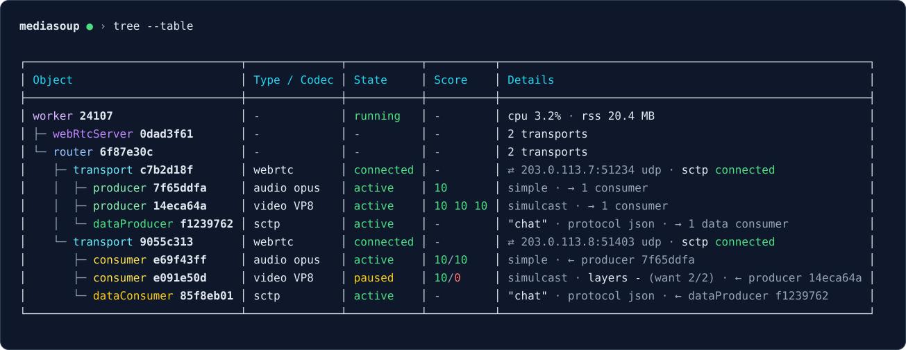

# mediasoup-cli

A live terminal monitor for [mediasoup](https://mediasoup.org) servers. Add one line to your app, then inspect workers, routers, transports, producers and consumers, follow lifecycle events, read RTP stats and search by `appData`, all from a second terminal.



<details>
<summary>View the table tree as text</summary>

```text
mediasoup ● › tree --table

┌────────────────────────────────┬──────────────┬───────────┬──────────┬───────────────────────────────────────────────────────┐
│ Object                         │ Type / Codec │ State     │ Score    │ Details                                               │
├────────────────────────────────┼──────────────┼───────────┼──────────┼───────────────────────────────────────────────────────┤
│ worker 24107                   │ -            │ running   │ -        │ cpu 3.2% · rss 20.4 MB                                │
│ ├─ webRtcServer 0dad3f61       │ -            │ -         │ -        │ 2 transports                                          │
│ └─ router 6f87e30c             │ -            │ -         │ -        │ 2 transports                                          │
│    ├─ transport c7b2d18f       │ webrtc       │ connected │ -        │ ⇄ 203.0.113.7:51234 udp · sctp connected              │
│    │  ├─ producer 7f65ddfa     │ audio opus   │ active    │ 10       │ simple · → 1 consumer                                 │
│    │  ├─ producer 14eca64a     │ video VP8    │ active    │ 10 10 10 │ simulcast · → 1 consumer                              │
│    │  └─ dataProducer f1239762 │ sctp         │ active    │ -        │ "chat" · protocol json · → 1 data consumer            │
│    └─ transport 9055c313       │ webrtc       │ connected │ -        │ ⇄ 203.0.113.8:51403 udp · sctp connected              │
│       ├─ consumer e69f43ff     │ audio opus   │ active    │ 10/10    │ simple · ← producer 7f65ddfa                          │
│       ├─ consumer e091e50d     │ video VP8    │ paused    │ 10/0     │ simulcast · layers - (want 2/2) · ← producer 14eca64a │
│       └─ dataConsumer 85f8eb01 │ sctp         │ active    │ -        │ "chat" · protocol json · ← dataProducer f1239762      │
└────────────────────────────────┴──────────────┴───────────┴──────────┴───────────────────────────────────────────────────────┘
```

</details>

Use `--table` to align object types, states and scores in columns while keeping the tree hierarchy:

```sh
npx mediasoup-cli tree --table
npx mediasoup-cli tree --table --routerId=6f87e30c
npx mediasoup-cli watch tree --table --interval=1s
```

Add `--full` for complete IDs. `--json` returns the same tree data in either view.

## Features

- **Everything mediasoup creates**: workers, WebRTC servers, routers, transports, producers, consumers, data producers and data consumers, each with its state (ICE/DTLS, scores, layers, paused…).
- **`tree`** view of the whole hierarchy.
- **`inspect`** any object: parents, children, consumers of a producer, and its `appData`.
- **`stats`** (mediasoup `getStats()`) and **`dump`** (`dump()`) for any object.
- **`find peerId=alice`**: search ids, labels and `appData` to go from your user to mediasoup ids.
- **`events`**: a log of created/closed objects, pause/resume, ICE/DTLS/tuple changes and layer switches.
- **`summary` / `top`**: object counts, worker CPU and memory, and health warnings.
- **`watch <command>`**: a live, full-screen refresh of monitoring commands (q to quit), pushed as soon as something changes.
- **Short ids**: every id argument accepts a unique prefix (`inspect 1a2b`), and tab completion knows the live ids.
- **Scriptable**: `npx mediasoup-cli show consumers --json | jq …`, with NDJSON output under `watch`.
- **Read-only by default**: listens on `127.0.0.1`, supports a token, rejects browser connections, and contains monitoring errors.
- **Optional server controls**: change worker logging and open a JavaScript REPL with live mediasoup objects.

## Install

```sh
npm install mediasoup-cli
# or
pnpm add mediasoup-cli
```

Requires Node.js 18+ and mediasoup 3.x (tested with 3.12 and 3.28).

## Usage

Call `observer()` once, **before creating workers**:

```js
const mediasoup = require("mediasoup");
const mediasoupCli = require("mediasoup-cli");
// or: import { observer } from "mediasoup-cli";

mediasoupCli.observer(mediasoup);
```

Then, from your app's directory, in another terminal:

```sh
npx mediasoup-cli            # interactive shell (history, tab completion)
npx mediasoup-cli tree       # or run a single command and exit
```

The CLI finds the port automatically: the observer writes it into the installed package's `config.env`.

## Commands

| Command | What it does |
| --- | --- |
| `show <kind> [filters]` | Table of objects. Kinds: `workers` `webrtcservers` `routers` `transports` `producers` `consumers` `dataproducers` `dataconsumers` |
| `show <kind> <id>` | Same as `inspect <id>` |
| `tree [<id>] [filters] [--full] [--table]` | Hierarchy, from a given object or from every worker; `--table` aligns states and scores |
| `inspect <id>` | Details, path, children, consumers of a producer, `appData` |
| `stats <id>` | `getStats()` of a transport/producer/consumer/data producer/data consumer, or worker resource usage |
| `dump <id>` | Raw `dump()` of the object |
| `find <text>` / `find key=value` | Search ids, labels and `appData` |
| `events [--limit=50] [--kind=<kind>]` | Recent events |
| `summary` | Counts, worker CPU/memory and warnings |
| `watch <command> [--interval=1s]` | Live view of any command above, `watch events` follows the log |
| `top` | `watch summary` |
| `logLevel <debug\|warn\|error\|none> [--workerId=<pid>]` | Change logging severity for all existing workers or one worker; requires `allowWorkerSettings` |
| `logTags <tag...> [--workerId=<pid>]` / `logTags --clear` | Replace worker log tags or clear them; requires `allowWorkerSettings` |
| `repl` / `js` | JavaScript console in the server, with `await` and live objects; requires `allowRepl` |
| `help [command]`, `version`, `clear`, `exit` | |

**Filters**: `--workerId=<pid>` `--routerId=<id>` `--transportId=<id>` `--producerId=<id>`. They match any ancestor, so `show consumers --routerId=7f3a` works.

**Output**: `--json` for machine-readable output (one JSON document per refresh with `watch`), `--no-color` (or `NO_COLOR=1`).

### Recipes

```sh
# Who is Alice and what does she send/receive?
find peerId=alice

# Is her audio actually flowing? (live bitrate, packet loss, score)
watch stats 7f65ddfa

# Who consumes this producer?
show consumers --producerId=7f65ddfa

# Why did this consumer disappear?
events --kind=consumer --limit=100

# Live dashboard
top

# CI / scripts
npx mediasoup-cli summary --json | jq '.warnings'
npx mediasoup-cli watch show workers --json --interval=5s >> workers.ndjson
```

The 1.x syntax still works: `show routers --workerId=123`, `watch transports --routerId=…`, `show transport routerid=…` and `show transports --transportId=… all`.

### Worker logging and JavaScript REPL

Enable each control in your application's observer configuration:

```js
mediasoupCli.observer(mediasoup, {
  allowWorkerSettings: true,
  allowRepl: true,
});
```

Then use these commands inside the CLI:

```text
logLevel debug
logTags ice dtls rtp
logLevel warn --workerId=12345
logTags score bwe --workerId=12345
logTags --clear
logLevel error
repl
```

`logLevel` and `logTags` affect all currently tracked workers unless you supply `--workerId` (unique prefixes work). Tags replace the previous list; `--clear` empties it. New workers still use your application's settings. Each command reports success or failure per worker, supports `--json`, and cannot be watched. Logs continue through your application's mediasoup logger; these commands do not stream worker logs into the CLI. See [mediasoup's logging settings](https://mediasoup.org/documentation/v3/mediasoup/api/#WorkerUpdateableSettings).

At the `js>` prompt, enter JavaScript directly:

```js
workers.size
[...routers.keys()]
await worker.dump()
const p = get("7f65ddfa") // use an actual id or unique prefix
await p.getStats()
await p.pause()
await p.resume()
```

The REPL uses [Node's native evaluator](https://nodejs.org/api/repl.html), including top-level `await`, multiline input, tab completion, `.help`, `.clear`, and `.exit`. `.exit`, Ctrl+D or Ctrl+C leaves the REPL and returns to the shell (or exits `mediasoup-cli repl`). JavaScript errors print in the REPL. Disconnecting ends the session; reconnecting requires opening a new one.

Available globals:

| Name | Value |
| --- | --- |
| `mediasoup` | The module passed to `observer()` |
| `get(id)` | Live object by full id, unique prefix or numeric worker pid |
| `workers`, `webRtcServers`, `routers`, `transports`, `producers`, `consumers`, `dataProducers`, `dataConsumers` | Maps of live objects, refreshed on each access. Keys are strings; pipe copies use `id@transportId`. A map saved in a variable is a snapshot. |
| `worker`, `webRtcServer`, `router`, `transport`, `producer`, `consumer`, `dataProducer`, `dataConsumer` | Most recently tracked live object of that kind, or `undefined` |
| `require`, `process` | Node access in the server; `require` resolves from the server's working directory |

REPL variables belong to each connection; mediasoup objects are shared with your running app. **Enabling `allowRepl` grants connected clients JavaScript execution with the server's privileges.** Code can change or close objects, block the event loop, or stop the process. Leaving the REPL does not undo changes or cancel work started by your code. Enable it only for trusted operators, and use a token for remote access. `allowWorkerSettings` and `allowRepl` default to `false`; enabling the REPL also lets code call `updateSettings()` directly.

## Options

```js
const handle = mediasoupCli.observer(mediasoup, {
  port: 5462,          // 0 = random port. Also $MEDIA_SOUP_CLI_PORT. (`PORT` is still accepted)
  host: "127.0.0.1",   // interface to bind. Also $MEDIA_SOUP_CLI_HOST
  token: "s3cret",     // require the CLI to send this token. Also $MEDIA_SOUP_CLI_TOKEN
  maxEvents: 1000,     // size of the event log
  allowWorkerSettings: false, // opt in to logLevel / logTags commands
  allowRepl: false,    // opt in to JavaScript execution in the server
});

await handle.ready;    // { host, port }, rejects if the port is taken (your app keeps running)
await handle.close();  // stop the server and detach every mediasoup listener
```

CLI connection flags: `--host`, `--port`, `--token`. Each falls back to its environment variable, then to `config.env`, then to the default.

### Remote servers and Docker

By default only processes on the same machine can connect. To monitor from elsewhere, bind to another interface and set a token:

```js
mediasoupCli.observer(mediasoup, { host: "0.0.0.0", token: process.env.MEDIA_SOUP_CLI_TOKEN });
```

```sh
npx mediasoup-cli --host 10.0.0.5 --token "$MEDIA_SOUP_CLI_TOKEN"
```

In a container you can also skip the network entirely with `docker exec -it <container> npx mediasoup-cli`.

> Treat the port like an admin interface. Monitoring can reveal internal details, and enabled controls allow changes to the server.

## Try it without an app

The repository ships a fake SFU that creates rooms and peers, sends fake RTP and keeps peers joining and leaving:

```sh
git clone https://github.com/musta20/mediasoup-cli && cd mediasoup-cli
npm install && npm install --no-save mediasoup
npm run demo          # terminal 1
npm start             # terminal 2
```

## Notes

- Only objects created after `observer()` is called are seen: call it before `createWorker()`.
- The view mirrors your app. An object you never close stays listed, which is often exactly the leak you were looking for.

## Upgrading from 1.x

- The server now binds to `127.0.0.1` instead of all interfaces. Pass `host: "0.0.0.0"` (ideally with a `token`) to keep remote access.
- `observer()` returns a handle (`ready`, `close()`) instead of `undefined`.
- Output is now tables with details instead of plain id lists. Use `--json` for scripts.

## Development

```sh
npm install
npm run build      # or: npm run watch
npm test           # node:test, no mediasoup needed
npm run demo       # needs: npm install --no-save mediasoup
```

For a real server and browser test, see [the live integration test guide](test/live/README.md). It runs the official mediasoup-demo with two Chrome users using synthetic camera and microphone streams:

```sh
MEDIASOUP_DEMO_DIR=/path/to/mediasoup-demo npm run test:live
```

For visible fake browser users and a CLI command checklist, see [manual testing](test/live/MANUAL.md).

## License

MIT
